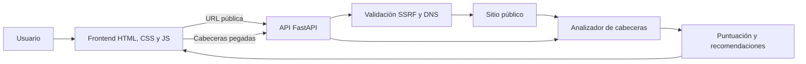

# Guía para publicar HeaderGuard en GitHub

Esta guía explica cómo presentar, mantener y publicar nuevas versiones de HeaderGuard en GitHub.

## 1. Crear el repositorio

En GitHub, crea un repositorio público llamado `HeaderGuard` y no marques las opciones para generar README, licencia o `.gitignore`: el proyecto ya incluye esos archivos.

Descripción sugerida para el campo **About**:

> Analizador visual de cabeceras HTTP de seguridad con FastAPI, puntuación explicada y protección SSRF.

Temas recomendados:

```text
cybersecurity http-security security-headers fastapi python ssrf web-security appsec
```

## 2. Enlaces configurados

Los botones, avisos de seguridad y borradores sociales ya apuntan a `https://github.com/abyssnx/HeaderGuard`. En `SECURITY.md` puedes añadir otro método privado de contacto si deseas recibir informes fuera de GitHub.

## 3. Subirlo manualmente desde la web

Esta es la opción más sencilla si no quieres utilizar Git:

1. Descomprime `HeaderGuard.zip`.
2. Entra en el repositorio vacío de GitHub.
3. Pulsa **Add file → Upload files**.
4. Arrastra **el contenido interior** de la carpeta `HeaderGuard`, no la carpeta completa.
5. Comprueba que `README.md`, `app`, `tests` y `.github` aparecen en la raíz.
6. Escribe `feat: publica HeaderGuard v1.3.0` como mensaje y confirma la subida.

GitHub puede ocultar la carpeta `.github` en algunos selectores de Windows porque empieza por punto. Si no se carga al arrastrar, usa los comandos de la siguiente sección o súbela por separado.

## 4. Subirlo desde PowerShell

Ejecuta estos comandos dentro de la carpeta `I:\Codex\HeaderGuard`:

```powershell
git init
git add .
git commit -m "feat: publica HeaderGuard v1.3.0"
git branch -M main
git remote add origin https://github.com/abyssnx/HeaderGuard.git
git push -u origin main
```

Si Git te pide identificarte antes del commit:

```powershell
git config user.name "TU_NOMBRE"
git config user.email "TU_EMAIL_PUBLICO_O_NOREPLY"
```

## 5. Comprobar la publicación

Después del primer `push`:

- Abre la pestaña **Actions** y comprueba que el flujo `CI` termina en verde.
- Revisa que el README muestre correctamente tablas, diagrama y enlaces.
- Comprueba que la licencia aparezca como MIT en la portada del repositorio.
- Activa **Issues** y **Discussions** si quieres recibir ideas de la comunidad.
- En **Settings → General**, permite solamente `Squash merging` si prefieres un historial limpio.
- En **Settings → Code security**, activa las opciones gratuitas disponibles para repositorios públicos.

## 6. Crear la primera versión

Cuando la acción de CI haya terminado correctamente:

1. Abre **Releases → Draft a new release**.
2. Crea la etiqueta `v1.3.0`.
3. Usa como título `HeaderGuard v1.3.0`.
4. Copia las novedades de `CHANGELOG.md`.
5. Adjunta `HeaderGuard.zip` si quieres ofrecer una descarga directa.

## 7. Cómo explicar el proyecto

### Resumen corto

HeaderGuard es una herramienta educativa que revisa nueve cabeceras HTTP de seguridad, detecta configuraciones débiles y produce una puntuación acompañada de recomendaciones. La edición Lite funciona con doble clic y sin instalación; la edición completa puede analizar una URL pública mediante FastAPI con protección SSRF.

### Problema que resuelve

Las cabeceras de seguridad suelen ser difíciles de interpretar para quien empieza en ciberseguridad. HeaderGuard convierte una respuesta HTTP en un informe visual y explica qué falta, por qué importa y cómo mejorarlo.

### Decisiones técnicas destacables

- El navegador nunca contacta directamente con el objetivo: lo hace una API controlada.
- El escáner rechaza redes privadas, loopback, credenciales y puertos no permitidos.
- Cada redirección se valida y la conexión queda fijada a una IP ya comprobada para reducir el riesgo de DNS rebinding.
- El historial se guarda localmente en el navegador y no almacena cabeceras ni cookies.
- El frontend no necesita framework ni compilación, reduciendo dependencias y superficie de ataque.

### Arquitectura



## 8. Demostración recomendada

Para enseñarlo en una entrevista, vídeo o publicación:

1. Abre `HeaderGuard-Lite.html` con doble clic para demostrar que no requiere instalación.
2. Pulsa **Cargar ejemplo**.
3. Ejecuta el análisis y enseña la puntuación y las prioridades.
4. Cambia una política segura por otra débil para mostrar las advertencias.
5. Exporta el JSON o copia el badge para demostrar que el informe se puede reutilizar.
6. Arranca la edición completa y explica la protección SSRF usando el diagrama anterior.

## 9. Qué no debes prometer

HeaderGuard es una ayuda educativa y no sustituye una auditoría profesional. Una cabecera presente puede seguir siendo insuficiente para una aplicación concreta, y una puntuación alta no garantiza que un sitio sea seguro.

---

Creado por **abyssnx**.
