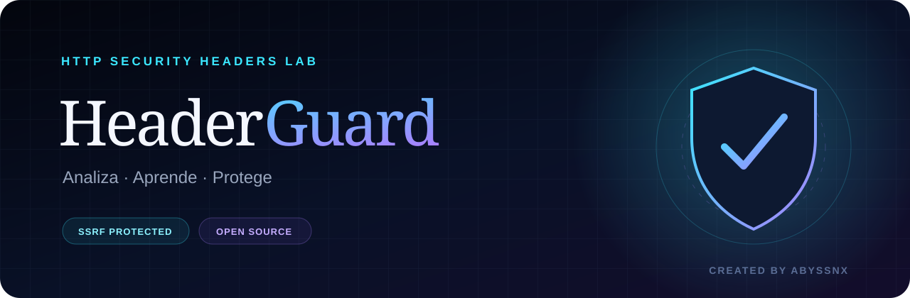
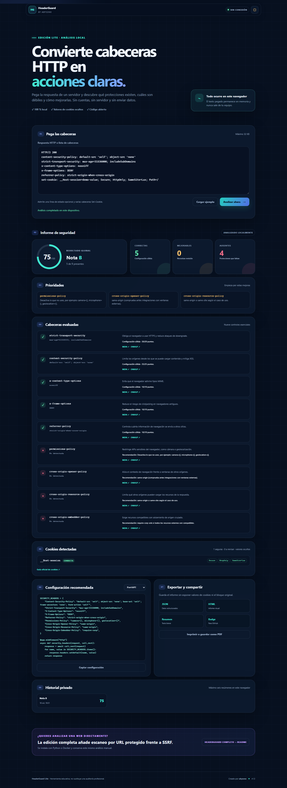

# HeaderGuard — HTTP Security Headers

HeaderGuard convierte cabeceras HTTP en un informe visual: comprueba nueve protecciones, detecta valores débiles, revisa atributos de cookies y explica cómo mejorar cada resultado.

[](https://github.com/abyssnx/HeaderGuard/actions/workflows/ci.yml)


## Elige cómo utilizarlo

| Opción | Recomendada para | Cómo empezar | Escanear una URL |
| --- | --- | --- | --- |
| **Lite** | Probar HeaderGuard al instante o trabajar sin conexión | Abrir [HeaderGuard-Lite.html](HeaderGuard-Lite.html) | No; analiza cabeceras pegadas |
| **Completa** | Analizar sitios públicos y usar la API | Instalar con Python o Docker | Sí, con protección SSRF |

Las dos opciones incluyen el mismo sistema de puntuación, recomendaciones, análisis de cookies, temas, historial privado, generador de configuraciones y exportaciones. Docker es opcional.

## Opción 1: HeaderGuard Lite

No necesita instalación, Python, Docker ni servidor.

1. Descarga el repositorio o el ZIP de la última versión.
2. Busca `HeaderGuard-Lite.html` y haz **doble clic**.
3. Pulsa **Cargar ejemplo** o pega tus propias cabeceras.
4. Pulsa **Analizar ahora**.

Todo ocurre dentro del navegador. El archivo no realiza peticiones automáticas, funciona sin internet y no guarda el texto pegado.



### Cómo conseguir cabeceras para pegarlas

Puedes copiarlas desde las herramientas de desarrollo del navegador:

1. Abre tu web y pulsa `F12`.
2. Entra en **Red** o **Network** y recarga la página.
3. Selecciona la petición principal.
4. Copia las **cabeceras de respuesta** y pégalas en HeaderGuard Lite.

También acepta texto como este:

```http
HTTP/2 200
content-security-policy: default-src 'self'
strict-transport-security: max-age=31536000; includeSubDomains
x-content-type-options: nosniff
```

## Opción 2: HeaderGuard completo

La edición completa añade análisis directo de URLs públicas y documentación interactiva de la API.

### Instalar con Python

Necesitas Python 3.11 o posterior.

1. Descarga o clona el repositorio y abre una terminal dentro de la carpeta `HeaderGuard`.
2. Crea un entorno aislado:

```bash
python -m venv .venv
```

3. Actívalo.

En Windows PowerShell:

```powershell
.venv\Scripts\Activate.ps1
```

En Linux o macOS:

```bash
source .venv/bin/activate
```

4. Instala y arranca HeaderGuard:

```bash
python -m pip install -e .
uvicorn app.main:app --reload
```

5. Abre [http://127.0.0.1:8000](http://127.0.0.1:8000). La API se documenta en [http://127.0.0.1:8000/api/docs](http://127.0.0.1:8000/api/docs).

### Instalar con Docker

Si ya utilizas Docker, no necesitas preparar Python manualmente:

```bash
docker build -t headerguard .
docker run --rm -p 8000:8000 headerguard
```

Después abre [http://127.0.0.1:8000](http://127.0.0.1:8000).

## Cómo usar la edición completa

### Escanear una URL

1. Mantén seleccionada la pestaña **Escanear URL**.
2. Escribe una dirección pública `http://` o `https://`.
3. Pulsa **Analizar**.

HeaderGuard valida el destino antes de conectarse, sigue redirecciones de forma controlada y muestra la URL final, la puntuación y las recomendaciones.

### Pegar cabeceras

1. Selecciona la pestaña **Pegar cabeceras**.
2. Pega el bloque o pulsa **Cargar ejemplo**.
3. Pulsa **Analizar**.

Este modo no contacta con la web analizada y resulta útil para entornos internos.

## Qué incluye el informe

- Puntuación de 0 a 100 y nota de A a F.
- Estados **correcta**, **mejorable** y **ausente**.
- Tres prioridades explicadas por impacto.
- Revisión de CSP, HSTS, políticas de origen y otras cabeceras.
- Análisis de `Secure`, `HttpOnly`, `SameSite` y prefijos de cookies sin revelar valores.
- Configuraciones para Nginx, Apache, FastAPI y Express.
- Exportación JSON, informe HTML, impresión/PDF, resumen y badge.
- Referencias educativas de MDN y OWASP.

## Modelo de puntuación

| Cabecera | Peso |
| --- | ---: |
| Content-Security-Policy | 25 |
| Strict-Transport-Security | 20 |
| X-Content-Type-Options | 10 |
| X-Frame-Options | 10 |
| Referrer-Policy | 10 |
| Permissions-Policy | 10 |
| Cross-Origin-Opener-Policy | 5 |
| Cross-Origin-Resource-Policy | 5 |
| Cross-Origin-Embedder-Policy | 5 |

La puntuación es educativa. Una nota alta no sustituye una auditoría ni garantiza que una aplicación sea segura.

## Seguridad y privacidad

La edición completa trata cualquier URL como hostil:

1. Solo acepta HTTP/HTTPS y los puertos 80/443, sin credenciales.
2. Rechaza loopback, redes privadas, metadatos cloud y cualquier IP no pública.
3. Fija la conexión a una IP ya validada manteniendo `Host`, SNI y la validación TLS.
4. Repite la validación en cada redirección.
5. Limita tiempo, redirecciones, tamaño de entrada y frecuencia.

En ambas ediciones, los valores de cookies se eliminan antes de mostrar, guardar o exportar resultados. Consulta [SECURITY.md](SECURITY.md) para informar de una vulnerabilidad.

## Solución de problemas

### Windows impide activar el entorno

Puedes ejecutar los comandos sin activarlo:

```powershell
.venv\Scripts\python.exe -m pip install -e .
.venv\Scripts\python.exe -m uvicorn app.main:app --reload
```

### El puerto 8000 ya está ocupado

Utiliza otro puerto y abre la dirección que aparezca en la terminal:

```bash
uvicorn app.main:app --reload --port 8080
```

### Una URL pública no puede analizarse

El sitio puede bloquear solicitudes automatizadas, utilizar un puerto distinto o resolver a una red no pública. Puedes copiar sus cabeceras y usar **Pegar cabeceras** o la edición Lite.

### Lite abre una página en blanco

Vuelve a descargar `HeaderGuard-Lite.html` completo y ábrelo con un navegador moderno. No lo guardes desde la vista previa de GitHub; utiliza **Download raw file** o el ZIP de la versión.

## Desarrollo y pruebas

```bash
python -m pip install -e ".[dev,ui]"
python -m playwright install chromium
python scripts/build_standalone.py --check
ruff check .
pytest --cov=app --cov-report=term-missing
```

GitHub Actions verifica el backend, las defensas SSRF, la paridad Python/JavaScript, el HTML generado y los dos recorridos reales con Chromium.

## Estructura del repositorio

```text
HeaderGuard/
├── HeaderGuard-Lite.html    # Edición autónoma lista para abrir
├── app/                     # API, escáner seguro e interfaz completa
├── standalone/              # Fuentes mantenibles de la edición Lite
├── scripts/                 # Generador determinista del HTML autónomo
├── tests/                   # Pruebas unitarias, seguridad y navegador
├── docs/
│   ├── ARQUITECTURA.md
│   └── assets/
├── .github/                 # CI, Dependabot y plantillas
├── Dockerfile
├── SECURITY.md
└── LICENSE
```

La explicación técnica de ambas ediciones está en [docs/ARQUITECTURA.md](docs/ARQUITECTURA.md). Las novedades se publican en [CHANGELOG.md](CHANGELOG.md).

## Colaborar

Lee [CONTRIBUTING.md](CONTRIBUTING.md) antes de proponer cambios. Utiliza únicamente sistemas propios o para los que tengas autorización.

## Licencia

Publicado bajo licencia [MIT](LICENSE).

---

Creado por **abyssnx**.
