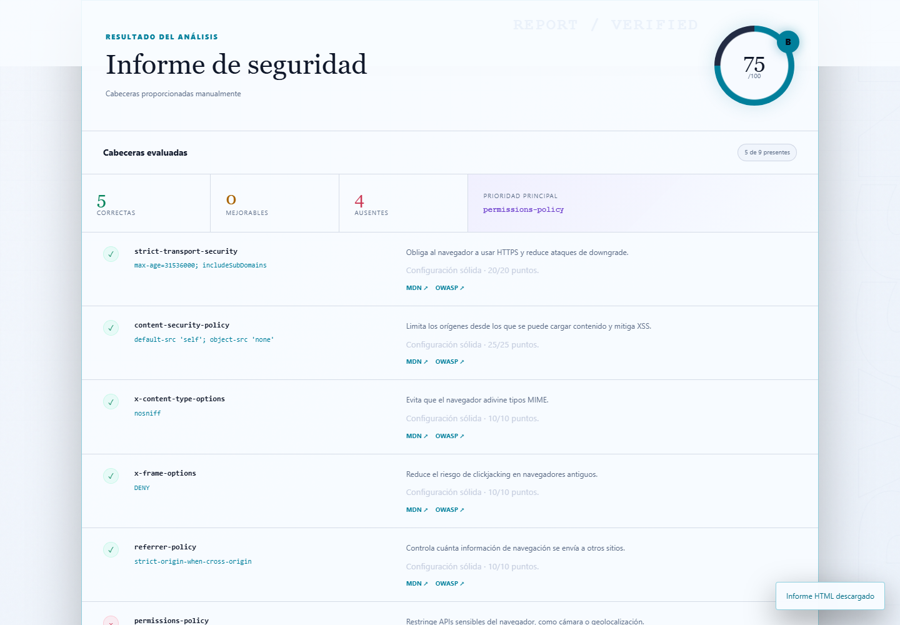

# HeaderGuard — HTTP Security Headers

HeaderGuard es una aplicación web educativa que analiza cabeceras HTTP de seguridad. Permite consultar una URL pública o pegar cabeceras manualmente y genera una puntuación acompañada de explicaciones y recomendaciones.

Creado por **abyssnx**.


> Consulta la [guía para publicar y presentar el proyecto](GUIA_GITHUB.md) si vas a subirlo por primera vez a GitHub.

## Características

- Interfaz moderna, responsive y accesible, sin proceso de compilación frontend.
- Identidad visual propia en azul abisal, cian y violeta, con indicadores cromáticos para los resultados.
- Análisis de nueve cabeceras: CSP, HSTS, X-Content-Type-Options, X-Frame-Options, Referrer-Policy, Permissions-Policy, COOP, CORP y COEP.
- Validación de valores débiles o permisivos, con puntuación parcial y prioridades.
- Modo seguro de cabeceras pegadas para instalaciones que no quieran habilitar red saliente.
- Escaneo remoto con defensas SSRF por capas.
- Historial privado en el navegador, comparación entre análisis y temas claro/oscuro.
- Exportación JSON, impresión/PDF, resúmenes copiables e insignias para GitHub.
- Informe HTML autónomo y compartible, sin valores de cookies.
- Análisis de `Secure`, `HttpOnly`, `SameSite` y prefijos seguros de cookies.
- Generador de configuración para Nginx, Apache, FastAPI y Express.
- Referencias educativas oficiales de MDN y OWASP en cada resultado.
- Límite básico por IP, tiempo máximo, redirecciones limitadas y tamaño de entrada acotado.
- Tests unitarios y de API, lint y cobertura en GitHub Actions.
- Pruebas automáticas con Chromium para escritorio y móvil.
- Imagen Docker ejecutada como usuario sin privilegios.

## Por qué es diferente

HeaderGuard no se limita a comprobar si una cabecera existe. También identifica valores comunes que reducen su protección, diferencia entre advertencias y ausencias, y ordena las mejoras por impacto. El análisis se presenta de forma educativa para que el resultado sea útil incluso sin experiencia previa en seguridad web.

El modo remoto se ha diseñado partiendo de que cualquier URL introducida es hostil. La resolución DNS, la IP conectada y cada redirección se validan antes de continuar.

## Vista previa



Las capturas completas de [escritorio](docs/assets/headerguard-desktop.png) y [móvil](docs/assets/headerguard-mobile.png) también están disponibles en el repositorio y se regeneran en la integración continua.

## Inicio rápido

Requiere Python 3.11 o posterior.

```bash
python -m venv .venv
# Windows
.venv\Scripts\activate
# Linux/macOS
source .venv/bin/activate

python -m pip install -e ".[dev]"
uvicorn app.main:app --reload
```

Abre `http://127.0.0.1:8000`. La documentación de la API está en `http://127.0.0.1:8000/api/docs`.

### Docker

```bash
docker build -t headerguard .
docker run --rm -p 8000:8000 headerguard
```

## Uso

### Escanear una URL

Introduce una URL pública HTTP o HTTPS. HeaderGuard realiza primero una solicitud `HEAD`; si el servidor no la admite, usa un `GET` parcial. Las redirecciones se validan individualmente.

```bash
curl -X POST http://127.0.0.1:8000/api/scan \
  -H "Content-Type: application/json" \
  -d '{"url":"https://example.com"}'
```

### Analizar cabeceras pegadas

```bash
curl -X POST http://127.0.0.1:8000/api/analyze \
  -H "Content-Type: application/json" \
  -d '{"headers":"Content-Security-Policy: default-src '\''self'\''\nX-Content-Type-Options: nosniff"}'
```

## Modelo de puntuación

| Cabecera | Peso |
| --- | ---: |
| Content-Security-Policy | 25 |
| Strict-Transport-Security | 20 |
| X-Content-Type-Options | 10 |
| X-Frame-Options | 10 |
| Referrer-Policy | 10 |
| Permissions-Policy | 10 |
| Cross-Origin-Opener-Policy | 5 |
| Cross-Origin-Resource-Policy | 5 |
| Cross-Origin-Embedder-Policy | 5 |

La puntuación combina presencia y una validación pragmática de los valores. Las configuraciones débiles reciben puntuación parcial. Aun así, el contexto de cada aplicación requiere revisión manual.

## Protección frente a SSRF

El escaneo remoto se trata como una operación no confiable:

1. Solo se aceptan `http` y `https`, sin credenciales, en puertos 80/443.
2. Se resuelven todos los registros del host y se rechaza el destino si alguno no es una IP global pública.
3. La conexión se realiza directamente contra una de las IP ya validadas, manteniendo `Host`, SNI y validación TLS del dominio. Esto evita una segunda resolución susceptible a DNS rebinding.
4. Cada redirección se resuelve y valida de nuevo antes de seguirla.
5. Hay límites de tiempo, redirecciones, tamaño y frecuencia.

Para producción multiinstancia, sustituye el limitador en memoria por uno compartido (por ejemplo, Redis), configura límites de egreso en la infraestructura y ejecuta detrás de un proxy que normalice la IP del cliente. Si no necesitas escaneo remoto, elimina o deshabilita `/api/scan` y conserva `/api/analyze`.

## Tests

```bash
ruff check .
pytest --cov=app --cov-report=term-missing
```

Los tests cubren el analizador, la API y casos SSRF relevantes: loopback, metadatos cloud, redes privadas, puertos alternativos, DNS con resultados mixtos y redirecciones a IP privadas.

Las pruebas opcionales de interfaz utilizan Chromium:

```bash
python -m pip install -e ".[dev,ui]"
python -m playwright install chromium
pytest tests/test_ui.py
```

## Estructura

```text
headerguard/
├── .github/workflows/ci.yml
├── app/
│   ├── analyzer.py       # Reglas, puntuación y parser
│   ├── main.py           # API, límites y archivos estáticos
│   ├── scanner.py        # Cliente HTTP con protección SSRF
│   └── static/           # Interfaz HTML/CSS/JS
├── tests/
├── docs/assets/            # Recursos visuales de GitHub
├── CHANGELOG.md
├── CONTRIBUTING.md
├── Dockerfile
├── GUIA_GITHUB.md
├── LINKEDIN.txt
├── SECURITY.md
└── pyproject.toml
```

## Límites y uso responsable

- La presencia de cabeceras no equivale a seguridad completa.
- El análisis de cookies es heurístico: algunas cookies accesibles desde JavaScript pueden omitir `HttpOnly` de forma intencionada.
- Algunos sitios bloquean solicitudes automatizadas o `HEAD`.
- El host debe permitir salida TCP directa a los puertos 80/443. El escáner no usa proxies HTTP del entorno porque resolver de nuevo a través de un proxy rompería la fijación DNS que evita rebinding.
- Analiza únicamente activos propios o con autorización.
- No se almacena el contenido de las respuestas; solo se leen cabeceras y, en el fallback, una cantidad acotada del cuerpo.

## Próximas mejoras

- Internacionalización completa en inglés y español.
- Cliente CLI reutilizando el mismo motor de análisis.
- Importación de informes anteriores y comparación detallada por cabecera.
- Perfiles de puntuación adaptados a diferentes tipos de aplicación.
- Limitador compartido para despliegues con varias instancias.

## Participar y seguridad

- Para proponer cambios, consulta [CONTRIBUTING.md](CONTRIBUTING.md).
- Para informar de una vulnerabilidad, sigue [SECURITY.md](SECURITY.md) y evita las incidencias públicas.
- Las novedades de cada versión están en [CHANGELOG.md](CHANGELOG.md).

## Licencia

Publicado bajo licencia [MIT](LICENSE).
