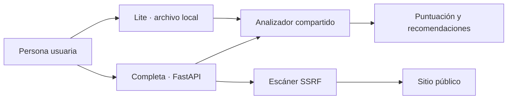

# Arquitectura de HeaderGuard

HeaderGuard ofrece dos ediciones que comparten el mismo modelo de puntuación, pero resuelven necesidades distintas.

## Edición Lite

`HeaderGuard-Lite.html` es un único archivo autónomo. El navegador ejecuta el parser, el análisis, el historial y las exportaciones localmente. No necesita servidor, no realiza peticiones automáticas y puede abrirse sin conexión.

El archivo se genera a partir de fuentes mantenibles:

```text
standalone/
├── lite.template.html
├── lite.css
└── lite.js
scripts/
└── build_standalone.py
```

El generador importa las reglas desde `app.analyzer.RULES`, inserta CSS y JavaScript y calcula los hashes de la política CSP. Esto evita mantener dos listas de reglas distintas y permite que la integración continua detecte un HTML desactualizado.

## Edición completa

La aplicación FastAPI sirve la interfaz completa y dos operaciones:

- `/api/analyze` analiza cabeceras pegadas.
- `/api/scan` consulta una URL pública mediante el escáner protegido frente a SSRF.

El escáner valida esquema, puerto, DNS, IP conectada y cada redirección. Solo permite destinos globales públicos, fija la conexión a una IP ya validada y mantiene la verificación TLS del nombre solicitado.



## Privacidad

- Los valores de `Set-Cookie` se descartan antes de mostrar o exportar resultados.
- Lite no guarda el bloque de cabeceras; el historial contiene únicamente fecha, puntuación, nota y contadores.
- La edición completa no almacena cuerpos de respuesta ni informes.

## Controles de calidad

Los tests comparan el motor JavaScript con Python, verifican casos SSRF, reconstruyen el HTML autónomo y abren ambas interfaces con Chromium. GitHub Actions repite estas comprobaciones en cada cambio.
